# 8-Bit Ripple Carry Adder Using Cadence Virtuoso

**An 8-bit Ripple Carry Adder (RCA) designed and analyzed in Cadence Virtuoso using a semi-custom VLSI design flow.**

## Overview

This project demonstrates the design, physical implementation, verification, and performance analysis of an 8-bit Ripple Carry Adder using Cadence Virtuoso. The adder is built from eight cascaded 1-bit full-adder stages. It accepts two 8-bit operands, `A[7:0]` and `B[7:0]`, along with an initial carry input, `Cin`, and produces an 8-bit sum, `S[7:0]`, and a final carry output, `Cout`.

The project follows a **semi-custom VLSI design flow**, covering schematic capture, symbol generation, physical layout, DRC, LVS, RC parasitic extraction (RCX), and pre-layout and post-layout transient simulations.

> **Complete project documentation:** The [`8bit_RCA_documentation.pdf`](8bit_RCA_documentation.pdf) file contains the full project report, including the design theory and Boolean equations, implementation details, schematic and layout figures, verification flow, simulation waveforms, power and delay measurements, calculations, comparison, discussion, and conclusion. Refer to the PDF for the complete explanation and detailed results; this README provides a repository overview and quick visual guide.

## Design Highlights

- **Architecture:** Eight cascaded 1-bit full-adder stages.
- **Inputs:** `A[7:0]`, `B[7:0]`, and `Cin`.
- **Outputs:** `S[7:0]` and `Cout`.
- **Design methodology:** Semi-custom VLSI design flow.
- **Physical verification:** Design Rule Check (DRC) and Layout Versus Schematic (LVS).
- **Parasitic extraction:** RCX extraction for post-layout analysis.
- **Performance analysis:** Pre-layout and post-layout average power and worst-case propagation delay.

For each bit position \(i\), the full-adder outputs are defined by:

$$\[
S_i = A_i \oplus B_i \oplus C_i
\]$$

$$\[
C_{i+1} = A_iB_i + C_i(A_i \oplus B_i)
\]$$

The complete adder performs:

$$\[
\{C_{out}, S[7:0]\} = A[7:0] + B[7:0] + C_{in}
\]$$

## Pre-Layout Design & Simulation

The pre-layout design was created and simulated using the schematic-level circuit in Cadence Virtuoso. The schematic connects eight full-adder stages in sequence, with each stage's carry output driving the next stage's carry input. A reusable symbol was also generated for the complete 8-bit adder.

### Schematic

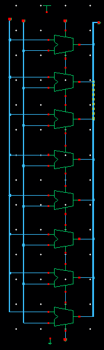

### Generated symbol

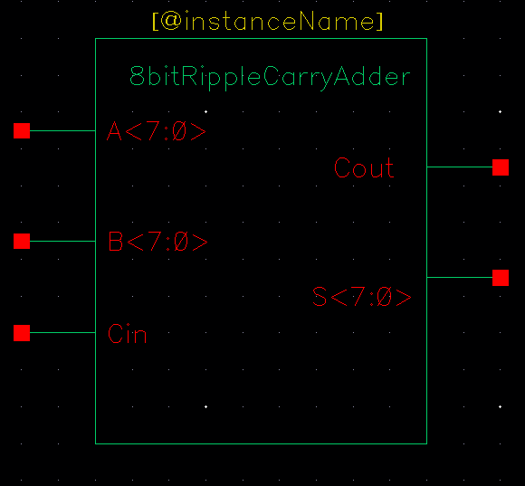

### Pre-layout transient waveforms

The following waveform captures show the pre-layout transient simulation results documented for the design.

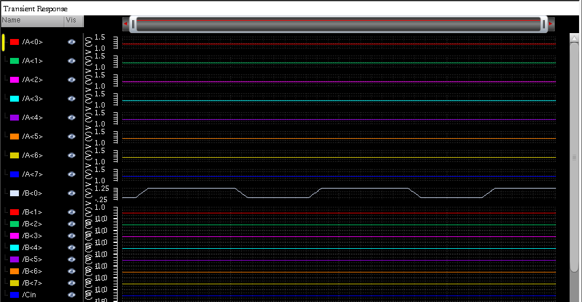

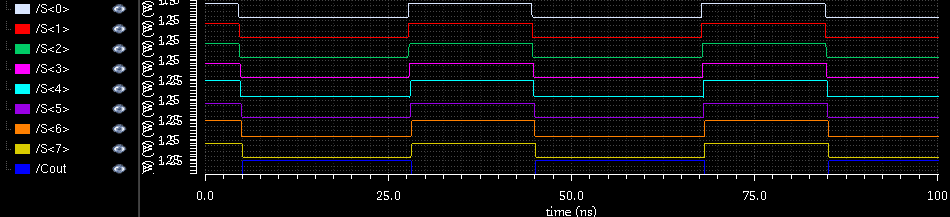

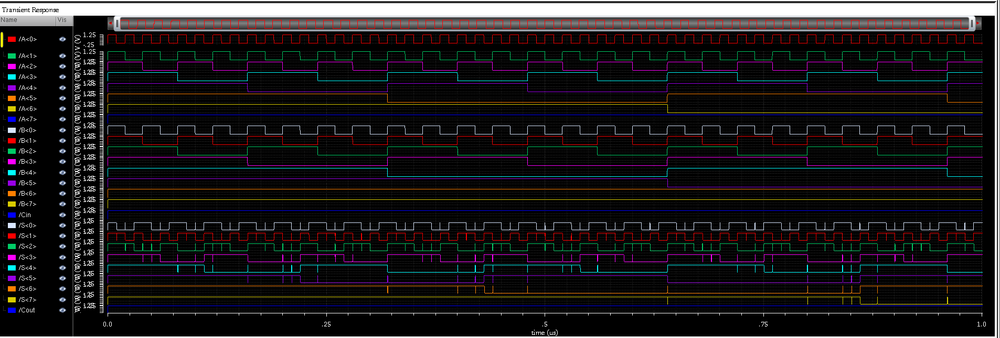

### Pre-layout measurements

**Average power**

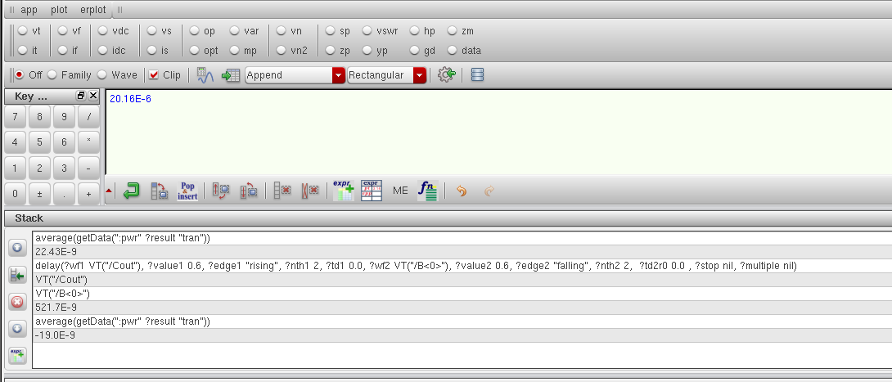

Measured pre-layout average power:

$$\[
P_{avg,pre} = 20.12\ \mu W
\]$$

**Worst-case propagation delay**

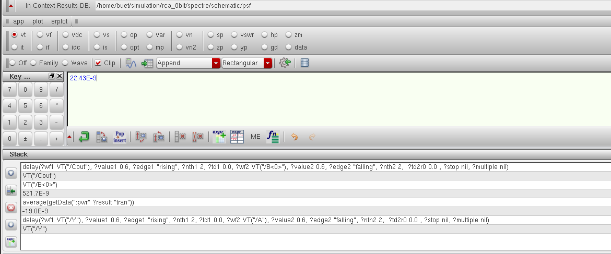

Measured pre-layout worst-case propagation delay:

$$\[
t_{pd,pre} = 22.43\ ns
\]$$

## Post-Layout Verification & Analysis

After schematic-level design and simulation, the physical layout was implemented in Cadence Virtuoso Layout Editor. The layout was checked using DRC and LVS, and RCX parasitic extraction was performed to generate the extracted circuit view used for post-layout simulation.

### Complete physical layout

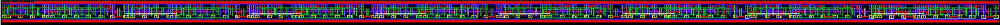

### Detailed layout views

The repository includes seven detailed layout captures for closer inspection of the physical implementation.

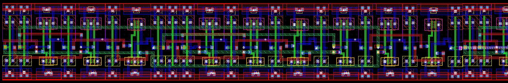

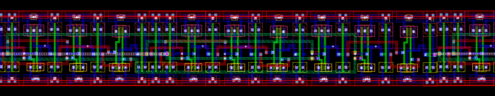


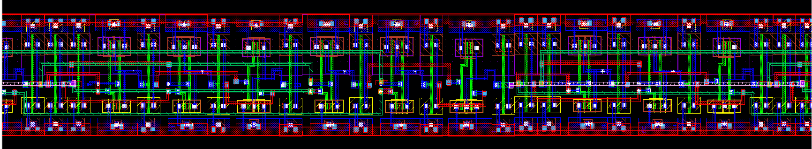

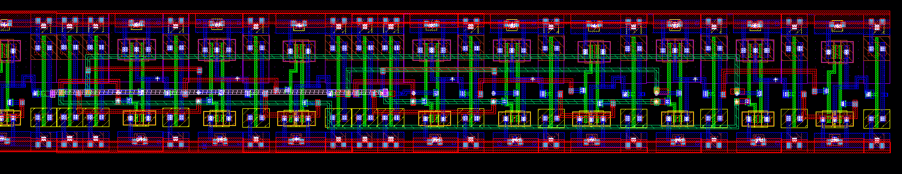

### Physical verification and parasitic extraction

- **DRC:** The project documentation records the result as **PASSED**.
- **LVS:** The project documentation records the result as **PASSED**.
- **RCX:** Parasitic extraction was performed, and the extracted view was used for post-layout simulation.

The DRC and LVS statuses should be checked against the final reports generated by the Cadence environment when reproducing or re-running the project.

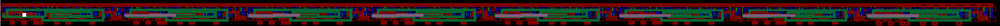

### Post-layout transient waveforms

The post-layout waveforms were obtained from transient simulation of the RCX-extracted circuit.

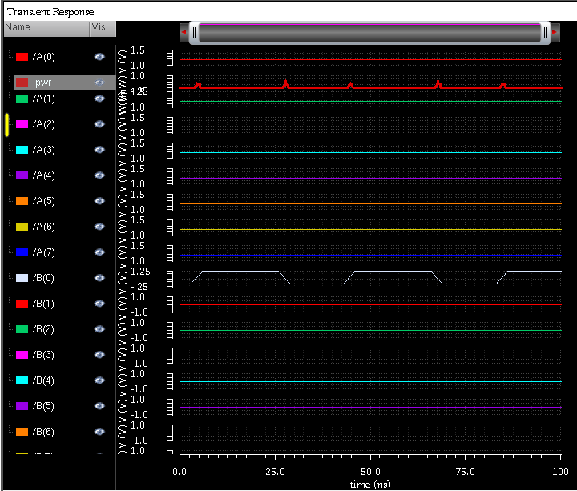

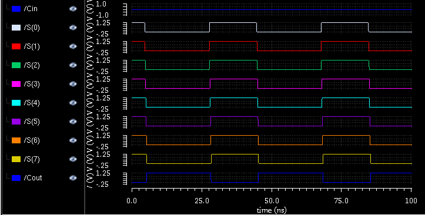

### Post-layout measurements

**Average power**

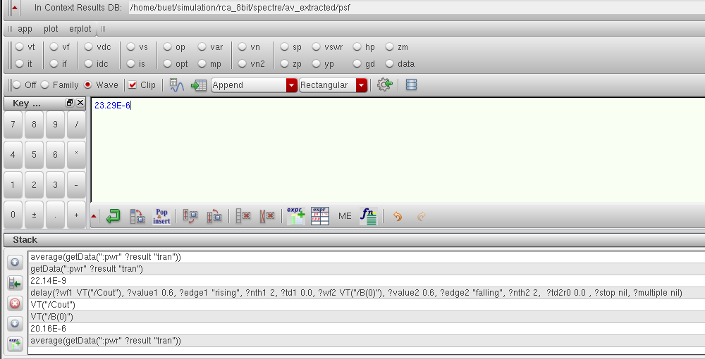

Measured post-layout average power:

$$\[
P_{avg,post} = 23.29\ \mu W
\]$$

**Worst-case propagation delay**

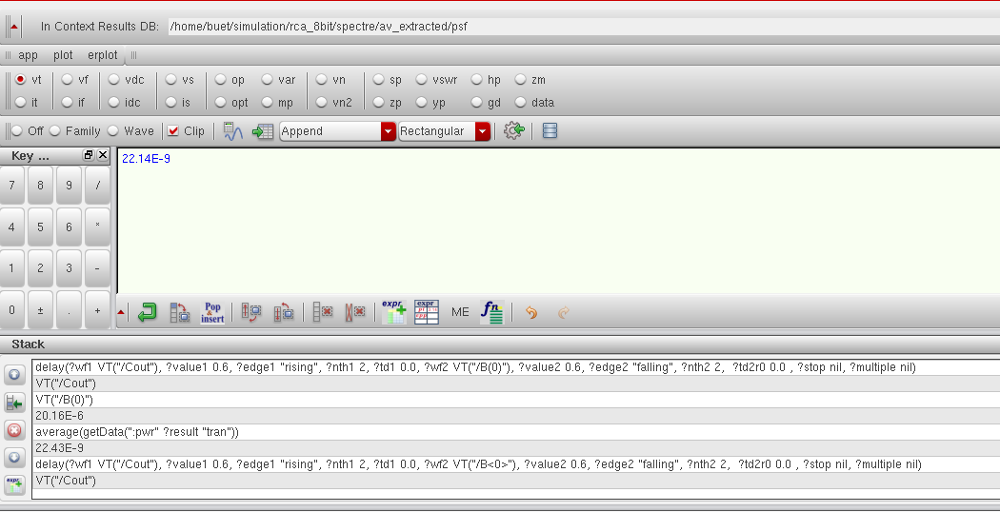

Measured post-layout worst-case propagation delay:

$$\[
t_{pd,post} = 22.14\ ns
\]$$

## Pre-Layout vs. Post-Layout Comparison

The measured pre-layout and post-layout results are summarized below.

| Parameter | Pre-layout | Post-layout | Change |
|---|---:|---:|---:|
| Average power | 20.12 µW | 23.29 µW | +3.17 µW (+15.76%) |
| Worst-case propagation delay | 22.43 ns | 22.14 ns | −0.29 ns (−1.29%) |

### Average power

The post-layout average power increased by **3.17 µW**, or approximately **15.76%**, compared with the pre-layout measurement.

### Worst-case propagation delay

The measured post-layout worst-case propagation delay decreased by **0.29 ns**, corresponding to approximately **1.29%**. This is the measured result for the simulation and delay-measurement conditions used in the project; it should not be taken as a general expectation that parasitic extraction reduces delay.

For a meaningful comparison, pre-layout and post-layout simulations should use consistent input patterns, supply conditions, measurement intervals, threshold definitions, and Calculator expressions. The PDF documentation provides the reported measurement context and calculations.

## Implementation Flow

The project follows this overall semi-custom design flow:

1. Design a 1-bit full-adder cell at the schematic level.
2. Instantiate and connect eight full-adder stages to create the 8-bit RCA.
3. Generate a reusable symbol for the complete adder.
4. Run pre-layout transient simulation and check the sum and carry outputs.
5. Implement the physical layout in Cadence Virtuoso Layout Editor.
6. Run DRC and LVS to check layout rules and schematic-to-layout consistency.
7. Perform RCX parasitic extraction.
8. Run post-layout transient simulation using the extracted view.
9. Measure average power and worst-case propagation delay, then compare the pre-layout and post-layout results.

Reproducing the design requires Cadence Virtuoso, a compatible CMOS PDK/technology setup, and the relevant simulation, verification, and extraction tools. Results may vary with the technology, device models, implementation, and simulation conditions.

## Repository Structure

```text
.
├── pre_layout/
│   ├── schematic.png
│   ├── symbol.png
│   ├── waveform1_state1.png
│   ├── waveform2_state1.png
│   ├── waveform_state2.png
│   ├── worstcase_delay_state1.png
│   └── worstcase_pwr_state1.png
│
├── post_layout/
│   ├── avextracted_full.png
│   ├── delay.png
│   ├── layout_1.png
│   ├── layout_2.png
│   ├── layout_3.png
│   ├── layout_4.png
│   ├── layout_5.png
│   ├── layout_6.png
│   ├── layout_7.png
│   ├── layout_full.png
│   ├── power.png
│   ├── waveform1_state3.png
│   └── waveform2_state3.png
│
├── 8bit_RCA_documentation.pdf
├── LICENSE
└── README.md
```

## Tools & Technologies

- Cadence Virtuoso Schematic Editor
- Cadence Virtuoso Layout Editor
- Cadence Spectre Simulator
- Design Rule Check (DRC)
- Layout Versus Schematic (LVS)
- RCX / Parasitic Extraction
- Cadence Virtuoso Calculator

## Documentation

For the **complete project details**, read [`8bit_RCA_documentation.pdf`](8bit_RCA_documentation.pdf). It includes the theoretical background, full-adder truth table and equations, stage-by-stage connections, schematic and symbol design, physical layout views, DRC/LVS discussion, RCX extraction, pre-layout and post-layout waveforms, Calculator measurements, performance calculations, comparison, and conclusion.

---

**Project:** 8-bit Ripple Carry Adder  
**Design flow:** Semi-custom VLSI  
**Design environment:** Cadence Virtuoso
